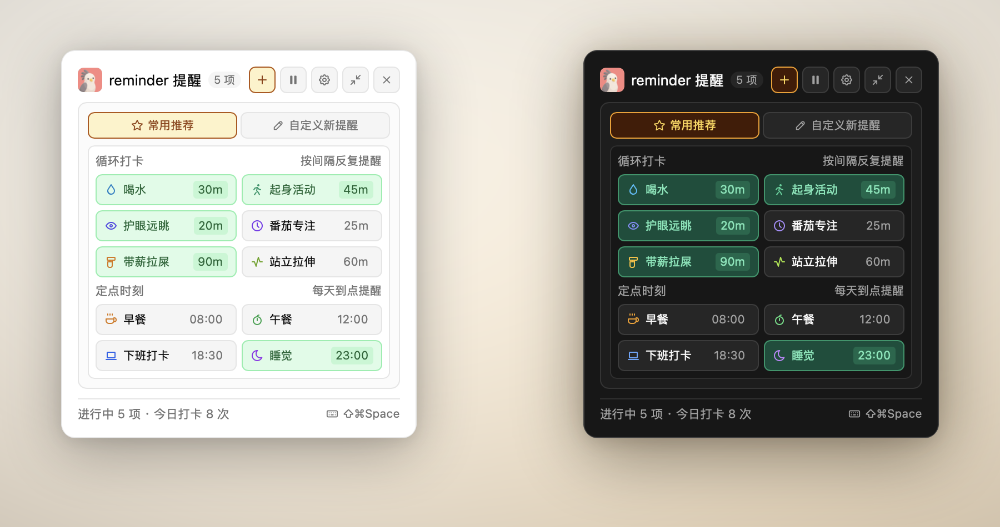

<div align="center">
  

  <h1>reminder 提醒</h1>

  <p>一张常驻桌面的小卡片，提醒你喝水、起身、护眼，按时吃饭和睡觉。</p>

  <p>
    
    
    
  </p>
</div>


<p align="center"><sub>主界面 · 左：浅色模式　右：深色模式</sub></p>

它不试图管理你的全部任务，只关心几件需要反复发生的小事：喝水、起身、护眼、按时吃饭和睡觉。到点会主动提醒，打卡后重新计时；收起成胶囊、收进托盘，计时也不会停。

## 功能

| 能力 | 说明 |
| --- | --- |
| **两种提醒节奏** | 每隔 N 分钟循环一次，或每天固定时刻提醒；自定义最长支持 24 小时 |
| **到点真的会叫你** | 提示音 + 原生通知 + 把悬浮窗唤到最前，不容易错过 |
| **打卡与今日统计** | 一键打卡、延后 5 分钟、环形进度；按天记录次数，底栏汇总今日打卡 |
| **常用预设** | 喝水、起身活动、护眼远眺、番茄专注、带薪拉屎、站立拉伸、早餐、午餐、下班打卡、睡觉 |
| **迷你胶囊** | 收起为 196×44 的小胶囊，优先显示最紧急的提醒，可直接打卡或展开 |
| **桌面集成** | 置顶悬浮、随处拖动、位置记忆、托盘常驻、全局热键、开机自启 |
| **外观** | 浅色 / 深色 / 跟随系统，20%–100% 窗口不透明度，金黄品牌强调色 |
| **本地优先** | 单个 JSON 文件，原子写入，离线时间补偿；联网只用于检查更新 |
| **自动更新** | 启动后静默检查新版本，下载校验后在你退出时替换，不打断提醒 |

## 快速开始

需要 [Rust](https://rustup.rs/) 与 `nsh` 0.7.0（安装方式见 [NSH 文档](https://nsh.dev/docs/installation)）。macOS 需要 Xcode Command Line Tools，Windows 需要 MSVC 生成工具，Linux 需要 GTK 4 开发库。

```sh
git clone https://github.com/b-yp/reminder.git
cd reminder
nsh run
```

`nsh run` 会用本机的原生桌面后端启动应用：macOS 上是 AppKit，Windows 上是 Win32，Linux 上是 GTK 4。
也可以直接 `cargo run`，同样会构建本机的原生后端。

打包：

```sh
nsh package --target macos    # 或 windows / linux
```

产物在 `.nsh/out/`。

## 下载安装

到 [Releases](https://github.com/b-yp/reminder/releases/latest) 下载对应平台的包。文件名里带着版本号，例如 `reminder-0.2.0-windows-x86_64.zip`：

| 平台 | 文件 |
| --- | --- |
| Windows | `reminder-<版本>-windows-x86_64-installer.exe`（安装版，装进当前用户）或 `reminder-<版本>-windows-x86_64.zip`（免安装） |
| macOS（Apple silicon） | `reminder-<版本>-macos-aarch64.tar.gz` |
| Linux（x86_64） | `reminder-<版本>-linux-x86_64.tar.gz`，需要 GTK 4.14 及以上 |

每个 release 都带一份 `latest.json`（自动更新用的清单）和 `SHA256SUMS.txt`（校验下载是否完整）。

> 目前没有购买代码签名证书：macOS 首次打开会被 Gatekeeper 拦下，执行
> `xattr -dr com.apple.quarantine /Applications/reminder.app` 后即可运行；
> Windows 会被 SmartScreen 提示「未知发布者」，点「更多信息 → 仍要运行」。

### 更新

从 0.2.0 起支持自动更新。启动约 15 秒后静默访问一次 GitHub Releases 的 `latest.json`：

- 有新版本时，设置抽屉的「应用更新」会出现「有新版本」和一个下载按钮；
- 点「下载更新」下载完整安装包，并按清单里的 SHA-256 校验、解包校验新应用；
- 校验通过后不打断你：**下次退出 reminder 时会自动装上新版本**；想马上生效就点「重启并更新」，
  应用会自己重启到新版本。

更新只替换应用本身，`state.json` 里的提醒、设置和窗口位置都保留。应用装在用户可写的目录里才会
自动替换（Windows 安装版默认装进 `%LOCALAPPDATA%\Programs\reminder`；macOS 放在 `/Applications`；
Linux 解压到自己的目录）。装在系统保护目录时，这一区会说明情况，并给一个「打开下载页」的按钮
直接跳到 release 页面手动替换。

> 0.1.0 / 0.2.0 之前的版本没有更新功能，需要手动装一次带更新的版本，之后才会自动更新。

## 使用

### 添加提醒

点顶栏的 **+**，进入「新建提醒」抽屉：



<p align="center"><sub>常用推荐 · 左：浅色模式　右：深色模式</sub></p>

常用推荐里点一下即可加入；已经在列表中的模板会显示为「已加入」，不会重复添加。

切到「自定义新提醒」可以自行配置名称、循环周期或每天定点，以及 16 个图标主题：


<p align="center"><sub>自定义新提醒 · 左：浅色模式　右：深色模式</sub></p>

### 打卡、延后与撤销

- 右侧 **✓** 打卡：记录次数、重置间隔，或把当天的定点提醒标记为完成。
- 点击行内的周期徽章（如 `30m`）可以快速轮换间隔时长；定点提醒按墙上时间走，不参与轮换。
- 行尾 **⋯** 菜单里有「延后 5 分钟」和「删除提醒」；删除后 5 秒内可以在底部 Toast 里撤销。
- 到期的行会变成淡红警示色，倒计时变成「超时 mm:ss」，迷你胶囊也会优先显示它。

### 迷你胶囊

顶栏右上角的收起按钮会把整张卡片折成 196×44 的胶囊，贴在屏幕边缘也不挡事：


<p align="center"><sub>迷你胶囊 · 左：浅色模式　右：深色模式</sub></p>

胶囊里显示当前最紧急的提醒，以及它在这批提醒中的位置（如 `3/5`）；点 **✓** 直接打卡，点展开按钮回到完整卡片。

### 偏好设置

点顶栏的齿轮打开设置：


<p align="center"><sub>偏好设置 · 左：浅色模式　右：深色模式</sub></p>

- **外观主题**：浅色、深色，或跟随系统。
- **窗口不透明度**：20%–100%，实时生效并记忆。
- **全局热键**：默认 macOS 为 `⌥⌘R`，Windows / Linux 为 `Ctrl+Alt+R`；可在「换一组」里轮换。
- **开机自启**：登录系统后自动运行，登记进各平台自己的启动项。

> 截图中的全局热键为 `⇧⌘Space`，默认值是 `⌥⌘R`，在设置里可以随时换一组。

### 托盘与关闭

关闭按钮不是退出，而是收进系统托盘；计时、提示音和托盘图标继续工作。左键点击托盘图标唤回窗口，右键菜单里可以显示 / 隐藏窗口，或真正退出。

## 数据与隐私

所有数据都在本机，没有账号、没有云同步。整个应用只有一处网络请求：检查更新时访问 GitHub 的
releases 清单和安装包，不上传任何数据，也没有统计埋点。

| 平台 | 状态文件 |
| --- | --- |
| macOS | `~/Library/Application Support/cc.baiyapeng.reminder/state.json` |
| Windows | `%APPDATA%\cc.baiyapeng.reminder\state.json` |
| Linux | `$XDG_CONFIG_HOME/cc.baiyapeng.reminder/state.json`（默认 `~/.config/…`） |

设置环境变量 `REMINDER_DATA_PATH` 可以把它指到任意位置。文件里保存提醒列表、主题、不透明度、热键、窗口位置和上次保存时间；写入采用临时文件 + 原子替换，避免意外关机写坏数据。启动时若发现距离上次保存已经过了一段时间，会把离线期间流逝的时间补算到未暂停的间隔提醒上（最多 7 天）。

## 项目结构

| 路径 | 职责 |
| --- | --- |
| `src/app.rs`、`src/app/` | 根组件、响应式状态上下文、托盘 / 关闭 / 主题 / 热键 / 心跳等应用级副作用 |
| `src/views/` | 完整卡片、迷你胶囊、顶栏与底栏、提醒列表、新建抽屉、设置抽屉、撤销 Toast |
| `src/ui/` | 应用自己的控件外观层与设计令牌，界面统一从这里组合 |
| `src/model.rs` | 提醒模型、间隔 / 定点调度、打卡与超时计算 |
| `src/storage.rs` | JSON 持久化、原子写入、离线时间补偿 |
| `src/window.rs` | 平台窗口层：置顶悬浮、透明度、托盘、关闭拦截 |
| `src/hotkey.rs`、`src/autostart.rs`、`src/alarm.rs` | 全局热键、开机自启、到期提示音与通知 |
| `src/updater.rs` | 应用更新：读打包配置、检查 / 下载新版本、退出时替换 |
| `src/theme_mode.rs`、`src/icons.rs`、`src/presets.rs` | 主题令牌与对比度测试、矢量图标、常用预设 |

界面遵循 NSH 的编码与设计规范：主题色统一来自 `nsh_base::theme()`，品牌金黄作为强调色，`theme_mode` 里有 WCAG AA 的对比度回归测试；交互控件基于 NSH 的语义组件构建，保留键盘操作与读屏标签。

## 开发与测试

```sh
nsh check                    # cargo check + TypeScript 测试的类型检查
nsh test                     # cargo test + App.test.tsx（无头）
nsh test nsh.json --trace    # 看根组件挂载了什么、每次提交的耗时
cargo test                   # 只跑 Rust 侧的无头 UI / 逻辑测试
```

`App.test.tsx` 用 TypeScript 驱动真实 Rust 根组件，覆盖了主界面、设置抽屉、新建抽屉和表单复位等流程。

README 里的截图不是设计稿：它们由 `nsh test --target macos` 驱动真实窗口，在 macOS 上分别以浅色和深色渲染后截取，再拼成一张对照图。截图后统一补了背景和投影，并裁掉了窗口自带的圆角阴影边缘。为了在一张图里完整展示抽屉内容，设置和自定义表单的截图把窗口临时拉高了；日常运行时窗口默认是 320×350，内容超出时在卡片内滚动。

## 发版

版本号由 [release-please](https://github.com/googleapis/release-please) 按 Conventional Commits 维护，打包由 GitHub Actions 完成：

1. 往 `master` 合入带 `feat:` / `fix:` / `feat!:` 前缀的提交；
2. release-please 会开一个 `chore(master): release x.y.z` 的 PR，里面已经改好 `Cargo.toml`、`Cargo.lock`、`nsh.json` 的版本号和 `CHANGELOG.md`；
3. 合并这个 PR：它打出 `v x.y.z` 的 tag，并建一个 **draft** release，然后自动触发打包流水线；
4. 三个平台都构建成功后，流水线用 `nsh update-manifest` 生成 `latest.json`（自动更新用的清单），
   校验清单里的 id、版本和三个平台的条目齐全，再把清单和产物一起挂上去、把 release 转正。
   任一平台失败，release 会停在 draft，用户看不到残缺版本，也不会把半成品推成「最新」。

产物里的版本号来自 tag，build 号来自 `GITHUB_RUN_NUMBER`，不需要手动改 `nsh.json` 的 `build`。

需要重跑某个版本的打包（例如当时某个平台挂了）：

```sh
gh workflow run release-and-package.yml --ref master -f tag=v0.2.0
```

## 平台说明

- macOS、Windows、Linux 上提供完整的悬浮窗、托盘、全局热键与开机自启。
- Web 和移动端目标可以运行界面，但没有系统托盘、全局热键和登录启动项；设置里会显示「不可用」。
- 提醒音使用系统默认提示音；通知走各平台原生通知中心，首次使用时可能需要授予通知权限。
- 默认窗口尺寸为 320×350（卡片）或 196×44（胶囊）；抽屉内容超出时在卡片内滚动。

<div align="center"><sub>愿它帮你记得喝水、起身，也记得按时休息。</sub></div>
